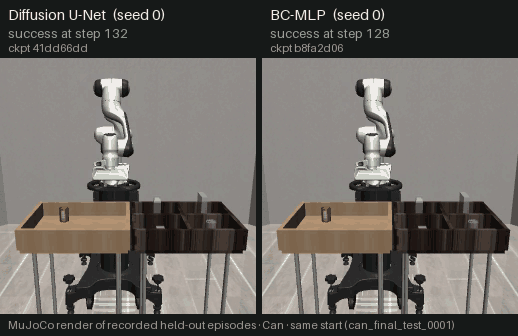
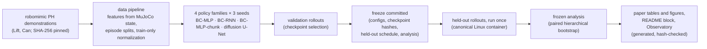

# RoboForge

**Can a diffusion model teach a robot arm to grasp and place objects?**



<sub>MuJoCo renders of two recorded held-out episodes (Can, seed 0 diffusion U-Net vs seed 0
BC-MLP, same start; both succeed). Chosen by a written rule, not by taste: the first held-out
start on which both succeed (DECISIONS D-089 rule 3(a), labelled "representative"). Sources,
checkpoints and transformation: [docs/media/readme_preview.json](docs/media/readme_preview.json).</sub>

RoboForge is a research project by **Zackary Holt**. It compares deterministic behavior
cloning, recurrent behavior cloning and a conditional diffusion action policy on simulated 3D
robotic manipulation. A 7-DoF Franka Panda arm in MuJoCo (through robosuite) learns the Lift
and Can tasks from the robomimic proficient-human demonstrations. Every policy is evaluated by
closed-loop simulator rollouts from paired, held-out initial states, under protocols that were
frozen and committed before the held-out starts were first used, and run once.

**[Read the paper](paper/main.pdf)**: *Learning 3D Robotic Manipulation from Demonstrations: A
Controlled Comparison of Behavior Cloning and Diffusion Policies* (a local build, not peer
reviewed). Every number in it is generated from the frozen result files.

**[Open the RoboForge Observatory](https://zackholt05-tech.github.io/roboforge/)**: an
interactive 3D site that replays recorded evaluation episodes, shows the diffusion sampler's
real denoising steps (replayed from recorded validation episodes) and presents the frozen
findings (GitHub Pages; built from commit `b4bd070`, every
served file checked against its `deploy.json` hash list, DECISIONS D-102).

## Key findings

<!-- BEGIN GENERATED: findings (scripts/readme_findings.py from paper/generated/numbers.tex; do not edit by hand) -->

**Level 1 held-out success** (exact simulator state as input, which is privileged information; 3 training seeds × 50 paired held-out starts = 150 episodes per cell, run once under the frozen protocol; 95 % hierarchical bootstrap interval, preregistered):

| Policy | Lift | Can |
|---|---|---|
| BC-MLP (one step) | **90.7 %** (136/150) [83.3, 96.7] | **76.7 %** (115/150) [62.7, 90.0] |
| BC-RNN (LSTM) | **100.0 %** (150/150) [100.0, 100.0] | **96.0 %** (144/150) [89.3, 100.0] |
| BC-MLP-chunk (16-step chunks) | **98.0 %** (147/150) [94.0, 100.0] | **96.0 %** (144/150) [88.7, 100.0] |
| Diffusion U-Net (10 DDIM steps) | **97.3 %** (146/150) [93.3, 100.0] | **95.3 %** (143/150) [89.3, 100.0] |
| Random actions (sanity) | **0.0 %** (0/50) | **0.0 %** (0/50) |

Differences below are in percentage points (pp) with the preregistered 95 % interval and verdict.

- **Diffusion − BC-MLP (H2):** Can +18.7 pp [+4.7, +32.7], separated (+). This separation is fragile: a seed-level t interval, computed after the audit and not preregistered, is [−4.5, +41.8] and includes 0 (KI-053). Lift +6.7 pp [−0.7, +14.7], not separated (seed-level interval [+1.9, +11.5], separated (+)).
- **Diffusion − BC-MLP-chunk (H2-c, same inputs, horizons and chunking; deterministic head):** Lift −0.7 pp [−5.3, +4.7], not separated; Can −0.7 pp [−8.7, +7.3], not separated. These data give no evidence that the generative model adds to observation history and action chunking. Diffusion is also not separated from BC-RNN on either task.
- **Action bound (KI-052):** the diffusion sampler keeps every action inside the training range; the BC heads are bounded only by the controller limits. This confounds H2-c and the robustness comparisons.
- **BC-RNN − BC-MLP (H3):** Lift +9.3 pp [+3.3, +16.7], separated (+); Can +19.3 pp [+5.3, +34.0], separated (+) (seed-level interval [−2.8, +41.5], fragile in the same way).
- **Cost:** diffusion took 19–26× the chunked MLP's CPU training time, and a diffusion decision (10 DDIM steps) took 22–27× as long.
- **Robustness (H4, preregistered perturbation sets, not the held-out test):** under the initial arm offset, diffusion degrades least on Lift (its drop is separated from each BC family's; minus the chunked MLP's: −40.0 pp [−54.0, −26.0], separated (−)); on Can the same contrast is +4.7 pp [−10.7, +20.7], not separated. KI-052 applies to both.
- **RGB study (Lift; two 84×84 cameras plus proprioception, ResNet-18 encoder):** visual diffusion 100.0 % (150/150) vs visual BC-chunk 99.3 % (149/150): +0.7 pp [+0.0, +4.0], not separated. Lift saturates for every policy, so it cannot rank them (KI-034).
- **Level 2 (Lift; DP3-inspired point clouds from sensor-like depth, 512 points):** under cube placements outside the demonstrations' range, the point-cloud diffusion policy reached 56.7 % vs 98.0 % for the frozen RGB diffusion policy (same head and training, different encoder and augmentation): −41.3 pp [−54.0, −28.0], separated (−). H5 is not supported; the explicit 3D input generalized worse here.
- **Paid compute:** $10.61 over 24 Modal launches (list price before credits); Level 1 trained on a local CPU.

<!-- END GENERATED: findings -->

The short answer: on these two tasks, the diffusion policy was not separated from a
deterministic MLP that sees the same history and predicts the same action chunks, and it cost
far more to train and to run. All of this is simulation with exact object state for Level 1; nothing here was run on a
physical robot.

## Research questions

Preregistered in [docs/RESEARCH_PROTOCOL.md](docs/RESEARCH_PROTOCOL.md) before any reported run:

- **H1:** trained policies beat a random-action baseline in closed loop.
- **H2:** the diffusion policy's success exceeds deterministic BC (H2-c: the chunked MLP, which
  shares the diffusion policy's inputs, horizons and chunking).
- **H3:** temporal context (an LSTM) helps over a one-step MLP.
- **H4:** the families differ in robustness to object-placement and arm-start perturbations.
- **H5 (Level 2):** point clouds generalize to new object placements better than RGB.

## How it works



<!-- BEGIN GENERATED: setup (scripts/readme_findings.py from paper/generated/numbers.tex; do not edit by hand) -->
- **Simulator:** MuJoCo 3.2.7 through robosuite v1.5.1 (`51cc017`); operational-space control of the end effector at 20 Hz, a 400-step horizon, success scored at the first success.
- **Data:** robomimic proficient-human (PH) demonstrations repackaged for robosuite v1.5, Hugging Face revision `74fa018`: Lift 200 demonstrations (180 train / 20 validation), Can 200 (180 / 20); robomimic `d309eae`.
- **Policies:** a one-step MLP, an LSTM (10-step window), an MLP that predicts 16-step action chunks, and a 1D temporal U-Net diffusion policy over the same chunks (100 training noise levels, 10 DDIM sampling steps), with 1,077,255–1,204,336 parameters each and a preregistered tuning budget of 4 configurations per family and task.
- **Evaluation:** 3 training seeds per family, 50 paired held-out starts per task, one canonical platform (a pinned Linux aarch64 container, image `1f685638f28c`), episode records with full kinematics, a failure taxonomy, and a hierarchical bootstrap over seeds and starts (10,000 resamples, 95 % intervals).
<!-- END GENERATED: setup -->

## What makes the results trustworthy

- **Freezes before tests.** `docs/FINAL_TEST_FREEZE.md` (Level 1),
  `docs/RGB_EXPERIMENT_FREEZE.md` and `docs/LEVEL2_EXPERIMENT_FREEZE.md` fix configurations,
  checkpoint hashes, held-out schedules and the analysis before any held-out start was used.
  Each held-out evaluation ran once; the code refuses to run it again.
- **Locked held-out starts.** The held-out suites stay locked by code until their freeze is
  committed; `make freeze-check` and the two gate commands check the frozen code and the gates.
- **Nothing typed by hand.** The paper's tables, figures and every prose number, and this
  README's findings block, are generated from hash-pinned frozen files
  (`make paper-check`, `make release-check`).
- **An independent audit.** [docs/AUDIT.md](docs/AUDIT.md) records four fresh-context audits
  (simulator and splits, statistics, spend and timeline, the paper's claims). Every finding
  has a correction or a disclosed limitation.
- **Negative and null results are reported.** For example, H2-c is not separated, the RGB
  comparison is not separated, and H5 is separated in the negative direction.
- **Spend is reconciled.** All paid compute (Modal) ran under committed owner approvals and
  reconciles launch by launch with Modal's billing ([reports/compute/](reports/compute/)).

## Reproduce

Requirements: macOS arm64 or Linux (x86_64 or aarch64), [uv](https://docs.astral.sh/uv/),
git; Node 24 for the site; [Tectonic](https://tectonic-typesetting.github.io/) for the PDF;
Docker for the canonical evaluation container. Full commands and what each proves:
[docs/REPRODUCIBILITY.md](docs/REPRODUCIBILITY.md).

```bash
git clone https://github.com/zackholt05-tech/roboforge.git && cd roboforge
make setup          # uv sync --frozen: Python 3.11 and the exact pins of uv.lock
make test           # full suite; dataset tests skip with a reason until the data exist
make download       # official Lift + Can PH datasets from the pinned revision, SHA-256 checked
make check-data build-data   # rebuild the processed features; must equal the committed manifests
make smoke-sim SMOKE_OUT=/tmp/smoke   # real reset/step/success/render on both tasks

make paper-check    # regenerate every paper table, figure and number from the frozen files
make paper          # build paper/main.pdf (Tectonic; first use fetches its TeX bundle once)
make release-check  # identity, trailers, secrets, paths, docs and the README block

make web-install web-data web-assets web-build web-test   # the Observatory site
cd website && npm run preview                              # http://127.0.0.1:4173
```

The frozen held-out targets (`make eval-final`, `make rgb-heldout`, `make pc-heldout` and
their analyses) are never to be run again; they refuse once their results exist.

**Not redistributed:** the datasets (downloaded and checked by `make download`), the trained
checkpoints and the per-episode rollout records (gitignored `runs/`). The
committed summaries, selections and analyses regenerate every reported number; re-running a
policy needs retraining it from the committed configurations.

**Resources:** Level 1 trained on a local CPU (an Apple-silicon laptop) at no cost; the RGB
and point-cloud studies trained on one NVIDIA L4 on Modal (the spend is in the findings above);
all evaluation ran on the local CPU container. Disk and time measured in the Session 12
fresh-clone reproduction are in [docs/FINAL_RELEASE_AUDIT.md](docs/FINAL_RELEASE_AUDIT.md).

## How the showcased episodes were chosen

Every clip in the README, the paper and the Observatory is a recorded evaluation episode,
re-rendered from its saved simulator states and never re-simulated. Selections follow written
rules fixed before export ([docs/DECISIONS.md](docs/DECISIONS.md) D-089): the first success and
first failure per task and family by sorted start, the first head-to-head starts where (a) both,
(b) only diffusion or (c) only BC-MLP succeed, and the first validation decisions for the
denoising traces. Case studies are labelled as such. The full ledger is
[docs/VISUAL_PROVENANCE.md](docs/VISUAL_PROVENANCE.md).

## Extensions: RGB and point clouds

Both optional studies ran, each separately preregistered, frozen and tested once:

- **RGB (Session 8):** visual BC-chunk vs visual diffusion on Lift from two cameras plus
  proprioception (ResNet-18 encoder, trained on one L4). Both reach the task's ceiling.
- **Level 2 point clouds (Session 9):** a DP3-inspired point-cloud diffusion policy (not a DP3
  reproduction) against the frozen RGB diffusion policy, from sensor-like depth and calibration
  only (no segmentation, no object pose). It generalized worse to shifted cube placements.

## Limitations

- **Simulation only**, with exact object state as input for Level 1 (privileged information).
- **Resolution:** three training seeds and one set of held-out starts per task cannot resolve
  differences of a few points near the ceiling; Lift saturates (KI-034), and several
  separations depend on how the seed-level uncertainty is modelled (KI-053).
- **A confound:** the diffusion sampler bounds actions to the training range, the BC heads do
  not (KI-052). An evaluation-only test that would separate the two effects was not run.
- **Scale:** a compact diffusion U-Net, matched in size to the BC models, and a small tuning
  budget; the results say nothing about large diffusion policies.
- **Platform:** physics is not bit-identical across platforms (KI-013); every reported rollout
  ran on one pinned Linux container.

The full list, with the audit findings, is §9 of the paper and
[docs/KNOWN_ISSUES.md](docs/KNOWN_ISSUES.md).

## Repository layout

```text
configs/             simulator, data, model, experiment and evaluation configurations
data/                manifests, episode splits, normalization, evaluation start suites (no datasets)
src/roboforge/       data, sim, models, train, eval, viz, compute, paper, release
scripts/             the command-line tools behind the Makefile
tests/               unit, simulator, integration, research_integrity, web_contract
infra/               the canonical evaluation container and the Modal entrypoint
reports/             evidence by session: results, analyses, figures, Observatory export
paper/               the LaTeX report, generated tables and figures, main.pdf
website/             the RoboForge Observatory (React Three Fiber, own lockfile)
docs/                status, decisions, known issues, ledger, freezes, audit, release audit
```

## Credits

Project author: **Zackary Holt**. RoboForge builds on robomimic and its datasets (Mandlekar et
al.), robosuite (Zhu et al.), MuJoCo (Todorov et al.), Diffusion Policy (Chi et al.), whose
conditional U-Net is adapted through robomimic, and the DP3 paper (Ze et al.), which inspired the
point-cloud arm. Licenses and required citations: [THIRD_PARTY_NOTICES.md](THIRD_PARTY_NOTICES.md).

To cite RoboForge, use [CITATION.cff](CITATION.cff); please also cite the datasets, simulators
and algorithms it builds on.

## License

Apache License 2.0 ([LICENSE](LICENSE), [NOTICE](NOTICE)). Third-party software, datasets and
assets keep their own licenses.
