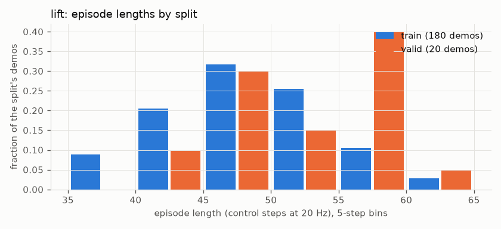
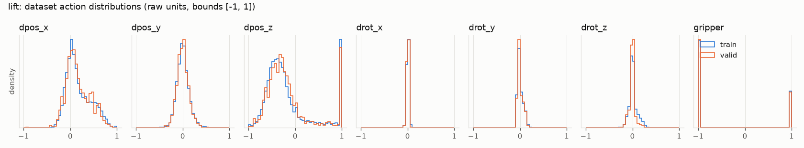
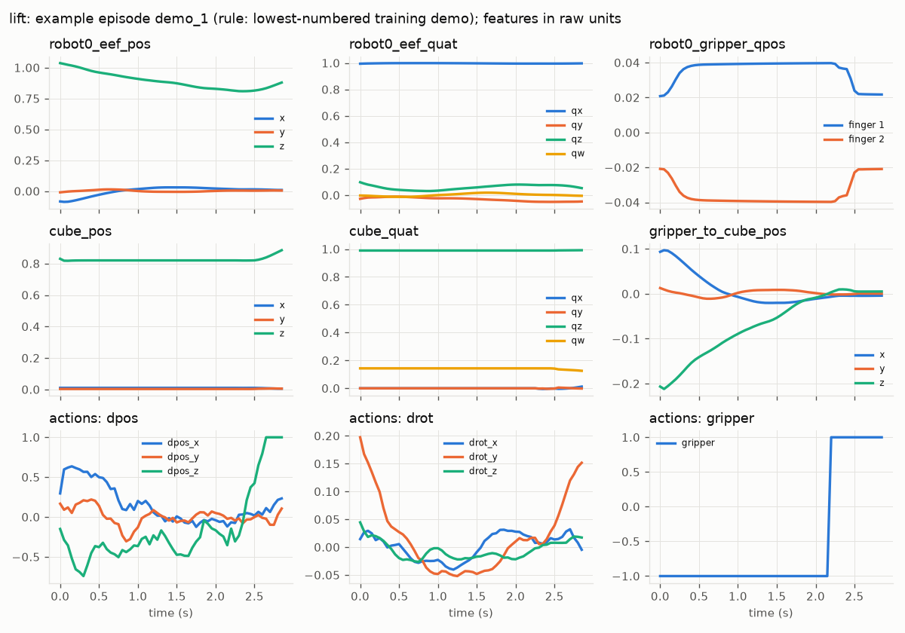
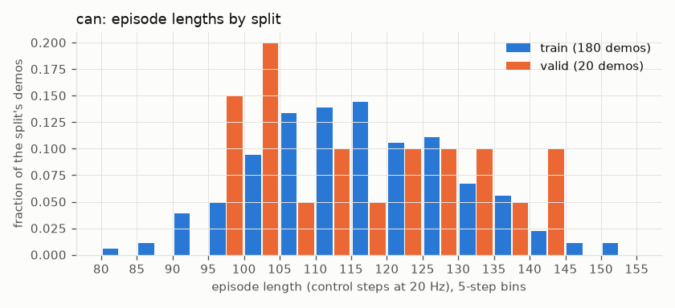
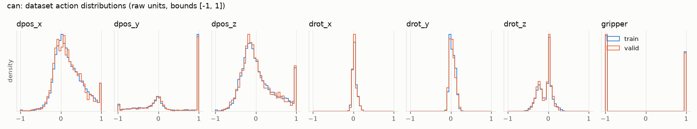
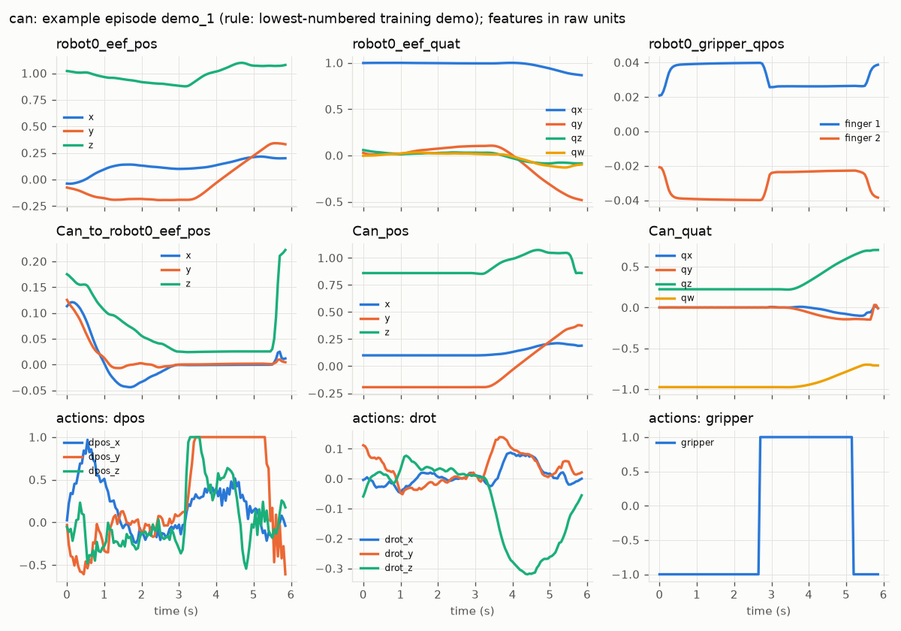

# Data Dictionary

> **Generated** by `scripts/audit_data.py` from `data/manifests/tasks/*.json` and `reports/data_audit.json`. Do not edit by hand; run `make audit-data`.

## Conventions (all tasks)

- **Observation**: the canonical Level 1 low-dim state vector, computed by `roboforge.data.features` from the flattened MuJoCo state `[time, qpos, qvel]` with `mj_kinematics` on a scratch `MjData`. The same function produces dataset windows and closed-loop evaluation inputs (D-010). Object features are exact simulator state: **privileged** relative to camera-based policies.
- **Quaternions** are `xyzw` (robosuite convention); MuJoCo `qpos`/`xquat` are `wxyz`. `robot0_eef_quat` is the orientation of the `robot0_right_hand` *body*, while `robot0_eef_pos` is the `gripper0_right_grip_site` position (robosuite ≤ 1.5 behaviour, robosuite issue #298).
- **World frame**: MuJoCo world, metres, z up.
- **Actions**: OSC_POSE deltas in the world frame (`input_ref_frame=world`) plus a binary gripper command; 20 Hz; stored values already lie in [−1, 1].
- **Windows** (`roboforge.data.sequence.SequenceDataset`): `obs_history[T_o, D]`, `obs_valid[T_o]`, `future_action[T_p, A]`, `valid_mask[T_p]`, `episode_id`, `start_t`. One window per decision step; the first observation is repeated before the episode start (`obs_valid=False`) and the last action after its end (`valid_mask=False`, excluded from losses). Defaults T_o = 2, T_p = 16.
- **Normalization**: per-dimension min-max to [−1, 1], fit on per-step arrays of training episodes only; dimensions with training range < 1e-4 use scale 1 (D-020). Model actions are decoded by inverting the transform and clipping to the action bounds.
- **Splits**: robomimic upstream `mask/train` / `mask/valid` (D-019). No demonstration test split exists: final tests use held-out simulator initial states.
- **Operator metadata**: none. The raw files hold one teleoperation channel per demo and no demonstrator identity, so no held-out-operator claims are possible.

## lift — `robomimic_v1.5/lift/ph` (Lift, robosuite 1.5.1)

| Item | Value |
|---|---|
| Source `low_dim` | `v1.5/lift/ph/low_dim_v15.hdf5`, 21,084,088 B, SHA-256 `2067777cb8b532e9263dd09fd6448c41cc31224bb27be4a3b734010ae13eb540` |
| Source `raw` | `v1.5/lift/ph/demo_v15.hdf5`, 36,699,586 B, SHA-256 `68f2a8cfe2502de1224f0708fb82e46da07abce108c63e721d72fc1618272f37` |
| Episodes | 200 (180 train / 20 valid), 9,666 steps |
| Episode length | 36–64 steps (mean 48.3); 1.80–3.20 s |
| Shortest / longest demo | `demo_73` (36) / `demo_167` (64) |
| Control / physics step | 0.05 s / 0.002 s |
| State vector | 32-D `[time, qpos, qvel]` |
| Success signal | robosuite Lift._check_success: cube body z > table top z + 0.04 m |
| Evaluation horizon | 400 control steps |
| Flagged episodes | none |
| Split | `data/splits/lift_ph.json` (SHA-256 `73097265526c03dfb7535aa9bff50aadd285cbfb554e563636d66395909c331e`) |
| Normalization | `data/normalization/lift_ph_lowdim_v1.json` (SHA-256 `253bfc7e63570bf3e8f8646a0094d1da4c5b729ba8f463b4955f01410b4812d6`) |
| Processed content | `$ROBOFORGE_DATA_ROOT/processed/robomimic_v1.5_ph/lift/lowdim_v1.hdf5` (SHA-256 `74e70119993830798c8b4ed87f202f64d8d2c9d573c0f376d54c4130e52d63c8`) |
| Observation spec | 19-D, SHA-256 `dfbd868e0ec11da76f66a71a9c3468e58590728ca95e93bbfb0a50ce182a7721` |
| Action spec | 7-D, SHA-256 `bcae0b7110c56e1bfdf8e2754c03ff95c8c9e77a34c56ef9ebae11e60d7fa77f` |

### Observation vector (`obs`, float32)

| Dims | Feature | Kind | MuJoCo source | Frame | Units | Privileged | robomimic block | Relation | Train min .. max |
|---|---|---|---|---|---|---|---|---|---|
| 0-2 | `robot0_eef_pos` | site_pos | gripper0_right_grip_site | world | m | no | `robot0_eef_pos[0:3]` | equal | -0.1477 .. 0.06221; -0.04519 .. 0.04451; 0.8088 .. 1.038 |
| 3-6 | `robot0_eef_quat` | body_quat_xyzw | robot0_right_hand | world | quat_xyzw | no | `robot0_eef_quat[0:4]` | equal | 0.9417 .. 1; -0.2573 .. 0.3311; -0.02229 .. 0.1618; -0.05882 .. 0.04287 |
| 7-8 | `robot0_gripper_qpos` | joint_qpos | gripper0_right_finger_joint1, gripper0_right_finger_joint2 | joint | m | no | `robot0_gripper_qpos[0:2]` | equal | 0.01459 .. 0.04021; -0.04032 .. -0.01723 |
| 9-11 | `cube_pos` | body_pos | cube_main | world | m | yes | `object[0:3]` | equal | -0.04511 .. 0.03492; -0.0353 .. 0.0498; 0.8159 .. 0.8867 |
| 12-15 | `cube_quat` | body_quat_xyzw | cube_main | world | quat_xyzw | yes | `object[3:7]` | equal | -0.0845 .. 0.06676; -0.09102 .. 0.05683; -0.0317 .. 0.9998; -0.9999 .. 1 |
| 16-18 | `gripper_to_cube_pos` | pos_diff_world | cube_main, gripper0_right_grip_site | world | m | yes | `object[7:10]` | equal | -0.04141 .. 0.1721; -0.05303 .. 0.04555; -0.2137 .. 0.01191 |

### Action vector (`actions`, float32)

| Dim | Name | Bounds | Physical scale at ±1 | Train min .. max | Train mean | Fraction at ±1 |
|---|---|---|---|---|---|---|
| 0 | `dpos_x` | [-1.0, 1.0] | ±0.05 m | -1 .. 1 | 0.1735 | 0.001273 |
| 1 | `dpos_y` | [-1.0, 1.0] | ±0.05 m | -0.56 .. 0.652 | 0.006366 | 0 |
| 2 | `dpos_z` | [-1.0, 1.0] | ±0.05 m | -1 .. 1 | -0.1699 | 0.09491 |
| 3 | `drot_x` | [-1.0, 1.0] | ±0.5 rad | -0.1507 .. 0.1186 | 0.003288 | 0 |
| 4 | `drot_y` | [-1.0, 1.0] | ±0.5 rad | -0.1404 .. 0.3051 | 0.005444 | 0 |
| 5 | `drot_z` | [-1.0, 1.0] | ±0.5 rad | -0.518 .. 0.4652 | 0.01353 | 0 |
| 6 | `gripper` | [-1.0, 1.0] | binary: −1 open, +1 close | -1 .. 1 | -0.4056 | 1 |

### Quaternion inputs

- `robot0_eef_quat`: 0 within-episode sign flips; w < 0 in 50.0% of steps (min |w| 8.2e-07).
- `cube_quat`: 0 within-episode sign flips; w < 0 in 49.1% of steps (min |w| 0.00038).

### Figures (generated; source tables in `reports/data_audit.json`)

## can — `robomimic_v1.5/can/ph` (PickPlaceCan, robosuite 1.5.1)

| Item | Value |
|---|---|
| Source `low_dim` | `v1.5/can/ph/low_dim_v15.hdf5`, 46,889,752 B, SHA-256 `3f2eb92e0a5025d0095e866ac16cc8092d6a762abe27dec90dbaff9027282962` |
| Source `raw` | `v1.5/can/ph/demo_v15.hdf5`, 64,932,974 B, SHA-256 `86961df85af1b9c6b9d4182a3755a8a4db6d0660cd550e45cca1f7accdb6d73d` |
| Episodes | 200 (180 train / 20 valid), 23,207 steps |
| Episode length | 82–151 steps (mean 116.0); 4.10–7.55 s |
| Shortest / longest demo | `demo_116` (82) / `demo_154` (151) |
| Control / physics step | 0.05 s / 0.002 s |
| State vector | 71-D `[time, qpos, qvel]` |
| Success signal | robosuite PickPlace._check_success (single-object mode): can inside its goal bin |
| Evaluation horizon | 400 control steps |
| Flagged episodes | none |
| Split | `data/splits/can_ph.json` (SHA-256 `743779b0ad9cacd5bab85a74421f6fba4ace5e980f5979a4a3534c82f042b46f`) |
| Normalization | `data/normalization/can_ph_lowdim_v1.json` (SHA-256 `e61dbf0c496171aabb09372a40f217b19bd3c32f08c3106079d6f268308be64a`) |
| Processed content | `$ROBOFORGE_DATA_ROOT/processed/robomimic_v1.5_ph/can/lowdim_v1.hdf5` (SHA-256 `5504b757beafee66b1265102953029fb4f19795460fe6c995ae169c24ff82d3c`) |
| Observation spec | 19-D, SHA-256 `71e89629bc3447b02b4bb7ec2f470e4a72f4d44ec04a74f90b6da146f425b71c` |
| Action spec | 7-D, SHA-256 `bcae0b7110c56e1bfdf8e2754c03ff95c8c9e77a34c56ef9ebae11e60d7fa77f` |

### Observation vector (`obs`, float32)

| Dims | Feature | Kind | MuJoCo source | Frame | Units | Privileged | robomimic block | Relation | Train min .. max |
|---|---|---|---|---|---|---|---|---|---|
| 0-2 | `robot0_eef_pos` | site_pos | gripper0_right_grip_site | world | m | no | `robot0_eef_pos[0:3]` | equal | -0.07376 .. 0.2961; -0.4195 .. 0.3937; 0.8602 .. 1.224 |
| 3-6 | `robot0_eef_quat` | body_quat_xyzw | robot0_right_hand | world | quat_xyzw | no | `robot0_eef_quat[0:4]` | equal | 0.5908 .. 1; -0.7352 .. 0.4723; -0.2286 .. 0.1381; -0.3427 .. 0.08067 |
| 7-8 | `robot0_gripper_qpos` | joint_qpos | gripper0_right_finger_joint1, gripper0_right_finger_joint2 | joint | m | no | `robot0_gripper_qpos[0:2]` | equal | 0.01541 .. 0.04106; -0.04031 .. -0.01176 |
| 9-11 | `Can_to_robot0_eef_pos` | pos_in_eef_frame | Can_main, gripper0_right_grip_site, robot0_right_hand | eef: grip-site position + right_hand body orientation | m | yes | `object[0:3]` | corrected_same_step | -0.1221 .. 0.2791; -0.1002 .. 0.3434; 0.00437 .. 0.3566 |
| 12-14 | `Can_pos` | body_pos | Can_main | world | m | yes | `object[7:10]` | equal | -0.04002 .. 0.2871; -0.4195 .. 0.4391; 0.8433 .. 1.215 |
| 15-18 | `Can_quat` | body_quat_xyzw | Can_main | world | quat_xyzw | yes | `object[10:14]` | equal | -0.6013 .. 0.6404; -0.5589 .. 0.6371; -0.7768 .. 0.9999; -0.9998 .. 0.9998 |

### Action vector (`actions`, float32)

| Dim | Name | Bounds | Physical scale at ±1 | Train min .. max | Train mean | Fraction at ±1 |
|---|---|---|---|---|---|---|
| 0 | `dpos_x` | [-1.0, 1.0] | ±0.05 m | -1 .. 1 | 0.1892 | 0.02145 |
| 1 | `dpos_y` | [-1.0, 1.0] | ±0.05 m | -1 .. 1 | 0.2611 | 0.3822 |
| 2 | `dpos_z` | [-1.0, 1.0] | ±0.05 m | -1 .. 1 | 0.04985 | 0.0373 |
| 3 | `drot_x` | [-1.0, 1.0] | ±0.5 rad | -0.5563 .. 0.7297 | 0.03141 | 0 |
| 4 | `drot_y` | [-1.0, 1.0] | ±0.5 rad | -1 .. 0.45 | 0.04082 | 4.789e-05 |
| 5 | `drot_z` | [-1.0, 1.0] | ±0.5 rad | -1 .. 0.7453 | -0.07829 | 0.0004789 |
| 6 | `gripper` | [-1.0, 1.0] | binary: −1 open, +1 close | -1 .. 1 | -0.1178 | 1 |

### Quaternion inputs

- `robot0_eef_quat`: 0 within-episode sign flips; w < 0 in 59.7% of steps (min |w| 4.5e-07).
- `Can_quat`: 0 within-episode sign flips; w < 0 in 46.4% of steps (min |w| 0.00026).
- `Can_to_robot0_eef_quat` is **not** an input (dropped, D-010): stored block 598 sign flips, same-step recomputation 446 flips over 23,207 steps.
- `Can_to_robot0_eef_pos` (KI-003 corrected): stored robomimic block minus corrected feature, max 0.861 m at t = 0 and 0.0914 m at t > 0; stored block equals the one-step-lag formula to 2.2e-16 m.

### Figures (generated; source tables in `reports/data_audit.json`)

